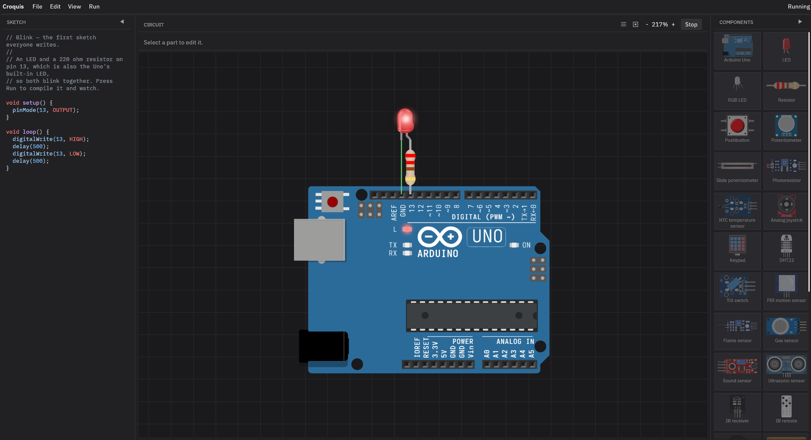

<div align="center">


# Croquis

**Draw an Arduino circuit, wire it to the Uno, and run a real AVR program — offline, on your own machine.**

[](LICENSE)
[](https://www.rust-lang.org)
[](#install)
[](https://github.com/emir12311/croquis/releases/latest)
[](https://github.com/emir12311/croquis/stargazers)



</div>

Croquis is a desktop simulator for Arduino circuits. Drag components onto a canvas, wire them up, write a sketch, press **Run**. The sketch is compiled to a real AVR program and executed instruction by instruction on `simavr`; the circuit around it is solved from your wires, so an LED with the right resistor lights at its simulated current — and one without a resistor is reported instead of lit.

**No server. No account. No telemetry. No network calls.** Everything — the compiler, the chip, the parts, the libraries — ships inside the app.

> **Written by AI, directed by a human.** The code, tests and docs are generated; the scope, the taste and the bug reports are mine. This release is a rewrite in Rust and egui of the Tauri app that came before it.

## Contents

[What it does](#what-it-does) · [Circuits](#twenty-four-circuits-to-start-from) · [Install](#install) · [Controls](#controls) · [How it works](#how-it-works) · [Under the hood](#under-the-hood) · [Limits](#what-it-doesnt-do-yet) · [Releases](#releases) · [Docs](#docs)

## What it does

| Category | Details |
| --- | --- |
| **Parts** | Arduino Uno, LEDs (including RGB), resistor, pushbutton, rotary and slide potentiometers, photoresistor, NTC temperature sensor, analog joystick, tilt / PIR / flame / gas / sound sensors, DHT22, HC-SR04, 4×4 keypad, IR receiver and remote, 74HC595, servo, stepper, LCD1602, buzzer, relay, 7-segment and 4-digit displays, LED bar — plus half and full breadboards |
| **Canvas** | Drag, rotate, and drop into breadboard holes; orthogonal wiring with draggable corners and re-pluggable ends; marquee select; undo/redo; copy, cut, paste and duplicate — parts and the wiring between them |
| **Simulation** | `avr-gcc` compiles, `simavr` runs. LEDs follow simulated current and PWM duty; buttons, joysticks and sensor modules drive the pins; DHT22, HC-SR04, keypad, stepper, IR and 74HC595 have protocol models; buzzer audio; relay contacts; a switch's bounce is modelled and optional |
| **Editor** | Completion from the Arduino API, auto-indent, wrapping, and the compiler's diagnostics listed with their line. A serial monitor that both prints and sends |
| **Files** | Wokwi's `diagram.json`, in both directions, sketch included. A circuit does not creep when it is opened and saved again |
| **Extras** | English and Turkish, a light and a dark theme, and a question before anything unsaved is thrown away |

## Twenty-four circuits to start from

**File → Presets → Basics / Sensors / Outputs** — each one a real `diagram.json` with its sketch, so you can press Run before writing anything.

<details>
<summary><b>Show the list</b></summary>

<br>

| Group | Circuits |
| --- | --- |
| **Basics** | Blink · Button · Button + serial · Fade |
| **Sensors** | Potentiometer · Slide potentiometer · Photoresistor · Thermometer · DHT22 · Digital sensors · Gas sensor · Joystick · Keypad · IR remote · Ultrasonic |
| **Outputs** | RGB LED · Seven segment · Four digit · LED bar · Servo · Stepper · Shift register · LCD 1602 · Buzzer & relay |

</details>

## Install

Every package carries the AVR toolchain and the bundled Arduino libraries, so a sketch compiles on a machine that has never had `avr-gcc` installed. All four are on the [Releases](https://github.com/emir12311/croquis/releases/latest) page.

| Format | Command |
| --- | --- |
| **AppImage** — recommended | `chmod +x croquis-*.AppImage && ./croquis-*.AppImage` |
| **.deb** — Debian, Ubuntu, Mint | `sudo apt install ./croquis_*.deb` |
| **.rpm** — Fedora, openSUSE | `sudo dnf install ./croquis-*.rpm` |
| **Arch package** — Arch, Artix, Endeavour | `sudo pacman -U croquis-*.pkg.tar.zst` |

One file and no root with the AppImage; every other format installs the app, its icon and the menu entry together, and removes with `apt remove croquis`, `dnf remove croquis` or `pacman -R croquis`.

<details>
<summary><b>Build from source</b></summary>

<br>

Requirements: a glibc Linux, [Rust](https://rustup.rs) with a C toolchain, and ALSA plus the usual X11/Wayland/GL development headers (`alsa-lib`, `libxkbcommon`, `libglvnd` on Arch).

```bash
git clone https://github.com/emir12311/croquis
cd croquis
./scripts/setup-toolchain.sh        # simavr, avr-gcc and the Arduino core, ~36 MB
cargo run --release --manifest-path app/Cargo.toml
```

`./scripts/package.sh all` builds the four packages above from one staged payload, so they cannot disagree about what is inside.

</details>

## Controls

| Input | Does |
| --- | --- |
| Click a pin, then another pin | Wire them together |
| Click the same two pins again | Remove that wire |
| Click empty space mid-wire | Drop a corner, to route around a part |
| Select a wire, drag one of its corners | Move that bend |
| Select a wire, drag its endpoint | Re-route it to another pin |
| Drag empty space | Select everything inside the box |
| `Ctrl+A` | Select everything |
| Drag a part | Move it — the whole selection, if several are picked |
| `R` / `Shift+R` | Rotate 90° / 180° |
| Right-click a part or a wire | Copy, cut, duplicate, rotate, delete — and **Edit code** on the Uno |
| Right-drag or middle-drag | Pan |
| Wheel · `Ctrl +` · `Ctrl -` · `Ctrl 0` | Zoom toward the pointer · out · reset |
| `Ctrl+S` · `Ctrl+Shift+S` · `Ctrl+O` · `Ctrl+N` | Save · save as · open · new |
| `Ctrl+Z` · `Ctrl+Shift+Z` | Undo · redo |
| `Ctrl+C` · `Ctrl+V` · `Ctrl+X` · `Ctrl+D` | Copy · paste · cut · duplicate |
| `Delete` · `Backspace` | Delete the selection |
| `Esc` | Cancel a wire, or clear the selection |

## How it works

The sketch is not interpreted. It is compiled and then run, one instruction at a time, paced to real time:

```text
Your sketch
    │
    └──▶ avr-gcc ──▶ a real AVR program ──▶ simavr ──▶ pin 13 goes high
                                                             │
                                                             ▼
                                          the netlist works out what is
                                          wired to pin 13, and how much
                                          current will actually flow
                                                             │
                                                             ▼
                                          the canvas draws the LED lit —
                                          or burnt, if you left the
                                          resistor out
                                                             │
    and the other way, while you hold a button:              │
                                                             │
    the canvas ──▶ the netlist ──▶ set_input ──▶ simavr ─────┘

    and analogue input, which has no button to hold:

    the knob's position ──▶ the netlist ──▶ set_analog ──▶ simavr,
    held as a voltage, so analogRead(A0) re-reads it every loop
```

## Under the hood

| Category | Details |
| --- | --- |
| **Shell** | Rust and [egui](https://github.com/emilk/egui) — immediate mode, drawn by the app itself. There is no webview, no browser and no JavaScript in the loop |
| **Engine** | `crates/croquis-sim` compiles sketches and bridges [simavr](https://github.com/buserror/simavr); `crates/croquis-core` holds the netlist, the orthogonal router and the `diagram.json` format |
| **Part art** | The [Wokwi](https://github.com/wokwi/wokwi-elements) element SVGs, rasterised once into textures with [resvg](https://github.com/linebender/resvg) |
| **Editor** | [`egui_code_editor`](https://github.com/falcon7886/egui_code_editor) — completion, auto-indent and wrapping, on the shell's own colours |
| **Tests** | 258 of them: 171 in the app, 62 in the core, 25 in the simulator. All 24 presets are compiled, simulated and checked against a frozen v0.2 baseline |
| **Packaging** | One payload, four formats, built by `scripts/package.sh` — each package carries `usr/lib/croquis/{toolchain,libraries}` |

## What it doesn't do yet

- **One board.** A second Uno gets its own circuit but shares the single sketch.
- **A small electrical model, not a circuit solver.** A resistor does something real and a missing one is reported, and the potentiometer is a fixed divider between its rails. There are no arbitrary parallel networks.
- **Wokwi files open with one caveat:** a wire using Wokwi's `*` route separator draws a different path here, to the same pins.
- **No jumping to a line.** The editor widget exposes no way to place a caret, so a compiler error names its line but a click cannot take you there.

## Releases

| Release | Date | Since the previous | Explanation |
| --- | --- | --- | --- |
| v0.1 | 2026-10-18 | — | First release |
| v0.1.1 | 2026-10-18 | same day | Presets frame themselves on load; each compile gets its own build directory |
| v0.1.2 | 2026-10-18 | same day | Snapping fixes — a part moves only when *every* leg lands in a hole |
| v0.1.3 | 2026-10-20 | 2 days | A potentiometer you can turn while the sketch runs; compiler errors name their line |
| v0.2.0 | 2026-10-23 | 3 days | The rest of the starter kit: DHT22, keypad, stepper, IR, 74HC595, HC-SR04, an offline Servo |
| v0.3.0 | 2026-11-11 | 19 days | Rewritten in Rust and egui — no webview — and a language system: English and Turkish |
| v0.3.1 | 2026-11-13 04:56 | 2 days | Touching pins conduct, a resistor reads and draws its value, and the Tauri app is gone |

v0.3.0 is the same circuit editor rewritten in Rust with egui — [the notes](docs/releases/v0.3.0.md) say what changed.

## Docs

- [`docs/features.md`](docs/features.md) — everything it does, at length
- [`docs/dev-notes.md`](docs/dev-notes.md) — the stack, and the gotchas that cost time
- [`AGENTS.md`](AGENTS.md) — how to work on this repo

## License

**GNU Affero General Public License v3.0.** See [`LICENSE`](LICENSE), and [`NOTICE`](NOTICE) for what is bundled.

<div align="center">
<br>


<sub>No server, no account, no telemetry, no network calls.</sub>

</div>
