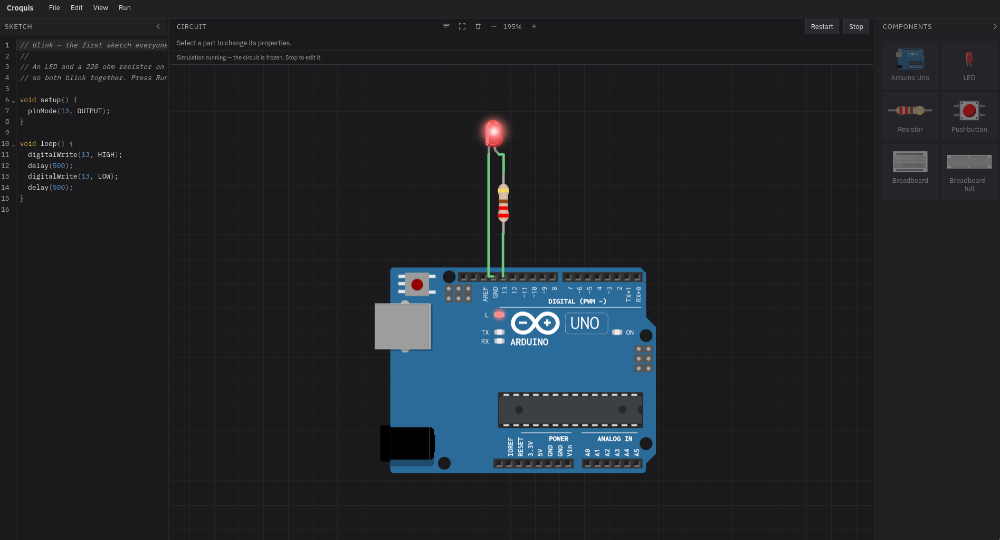

<div align="center">

[](https://github.com/emir12311/croquis/stargazers)
[](https://github.com/emir12311/croquis/issues)
[](https://www.gnu.org/licenses/agpl-3.0.html)

<br>


<br>

<h1>Croquis</h1>

<p>A circuit simulator, running entirely on your own machine.</p>

</div>



## What is Croquis?

A desktop app for building and running Arduino circuits without an Arduino.

You drag components onto a canvas, wire them up, write a sketch and press Run. The sketch is compiled locally with `avr-gcc` and executed on a simulated AVR chip.

There are three circuits to start from — **Blink**, **Button** and **Button + serial** — under File → Presets.

| Feature | What it does |
| --- | --- |
| **Parts** | Uno, LED, resistor, pushbutton, potentiometer; half and full breadboards |
| **Canvas** | Drag, rotate, snap; orthogonal wiring; multi-select; undo/redo; copy/paste |
| **Simulation** | `avr-gcc` + `simavr`; LEDs at simulated current, live buttons, analogue input, modelled bounce |
| **Editor** | CodeMirror + Arduino API completions; serial monitor docked beside the circuit |
| **Files** | Wokwi's `diagram.json` import and export, sketch included |

Written by AI, directed by me: the code, tests and docs are generated, the scope and the bug reports are mine.

## Why is Croquis?

I was frustrated by a gap in the industry: a circuit simulator that was local, offline, free and polished just didn't exist.

That's why I made Croquis. No server, no account, no telemetry, no network calls.

## How is Croquis?

The sketch isn't interpreted. It's compiled to a real AVR program and run instruction by instruction, paced to real time.

See the [How It Works](#how-it-works) section for the diagram.

## When is Croquis?

Took about 3 days for the v0.1 release.

Updates will come in the future.

## Installation

### AppImage — recommended

Download it from [Releases](https://github.com/emir12311/croquis/releases/latest), then:

```bash
chmod +x Croquis_*.AppImage
./Croquis_*.AppImage
```

One file, nothing to install, no root, works on any distribution. On first launch it adds itself to
your application menu, so after that you start it like anything else. Move the file and the menu entry
follows on the next run; delete it and there is nothing left behind.

### Debian, Ubuntu, Mint and anything else on apt

From the same [Releases](https://github.com/emir12311/croquis/releases/latest) page:

```bash
sudo apt install ./Croquis_*.deb
```

Installs the app, its icon and the menu entry together. `sudo apt remove croquis` removes all of it.

### Fedora, openSUSE and anything else on rpm

```bash
sudo dnf install ./Croquis-*.rpm   # or: sudo zypper install ./Croquis-*.rpm
```

### Arch, Artix, Endeavour

```bash
git clone https://github.com/emir12311/croquis
cd croquis/packaging/arch
makepkg -si
```

This builds from source — a few minutes — because there is no Arch repository for it.

### From source

Any distribution, if none of the above fit. Requirements:

* A **glibc** Linux — desktop is the only target so far
* [Node](https://nodejs.org) and `npm`
* [Rust](https://rustup.rs)
* WebKitGTK — `webkit2gtk-4.1`

```bash
git clone https://github.com/emir12311/croquis
cd croquis
./scripts/setup-toolchain.sh   # simavr, avr-gcc and the Arduino core, ~36 MB
npm install
./scripts/build-toolchain-dist.sh   # trims it to what ships: 276 MB → 153 MB
npm run tauri build
```

`npm run tauri dev` runs it live instead. The dev server is pinned to port `5173`; to run anything else
alongside it, use `npm run dev -- --port 5199`.

## Usage

Write a sketch, place parts, wire them up, and press **Run** in the top right of the circuit bar. While a sketch runs the circuit is frozen — **Restart** applies an edited sketch, **Stop** lets you rewire.

| Input | Does |
| --- | --- |
| Click a pin, then another pin | Wire them together |
| Click the same two pins again | Remove that wire |
| Click empty space mid-wire | Drop a corner, to route around a part |
| Drag a wire's middle | Slide that segment |
| Select a wire, drag its endpoint | Re-route it to another pin |
| Right-drag on empty space | Select everything inside the box |
| `Ctrl+A` | Select everything |
| Drag a part | Move it — the whole selection, if several are picked |
| Arrow keys | Nudge the selection one grid step |
| `R` / `Shift+R` | Rotate 90° / 180° |
| Right-click a part or a wire | Copy, cut, duplicate, rotate, delete — and **Edit code** on the Uno |
| Drag empty canvas | Pan |
| Wheel · `Ctrl +` · `Ctrl -` · `Ctrl 0` | Zoom toward the pointer · out · reset |
| `Ctrl+S` · `Ctrl+Shift+S` · `Ctrl+O` · `Ctrl+N` | Save · save as · open · new |
| `Ctrl+Z` · `Ctrl+Shift+Z` | Undo · redo |
| `Ctrl+C` · `Ctrl+V` · `Ctrl+X` · `Ctrl+D` | Copy · paste · cut · duplicate |
| `Delete` · `Backspace` | Delete the selection |
| `Esc` | Cancel a wire, or clear the selection |

## How It Works

```text
Your sketch
    │
    └──▶ avr-gcc ──▶ a real AVR program ──▶ simavr ──▶ pin 13 goes high
                                                             │
                                                             ▼
                                          the netlist works out what is
                                          wired to pin 13, and how much
                                          current will actually flow
                                                             │
                                                             ▼
                                          the canvas draws the LED lit —
                                          or burnt, if you left the
                                          resistor out
                                                             │
    and the other way, while you hold a button:              │
                                                             │
    the canvas ──▶ the netlist ──▶ set_input ──▶ simavr ─────┘

    and analogue input, which has no button to hold:

    the knob's position ──▶ the netlist ──▶ set_analog ──▶ simavr,
    held as a voltage, so analogRead(A0) re-reads it every loop
```

That's basically it.

## What it doesn't do yet

* **A handful of components.** An Uno, an LED, a resistor, a pushbutton, a potentiometer, breadboards. No buzzer, display or servo.
* **One board.** A second Uno gets its own circuit but shares the single sketch.
* **A small electrical model, not a circuit solver.** A resistor does something real and a missing one is reported, but there are no parallel networks and no voltage dividers.
* **Wokwi files open with one caveat:** a wire using Wokwi's `*` route separator draws a different path here, to the same pins.

## License

**GNU Affero General Public License v3.0.** See [`LICENSE`](LICENSE), and [`NOTICE`](NOTICE) for what is bundled.

## Docs

- [`docs/features.md`](docs/features.md) — everything it does, at length
- [`docs/dev-notes.md`](docs/dev-notes.md) — gotchas and the stack
- [`AGENTS.md`](AGENTS.md) — how to work on this repo
